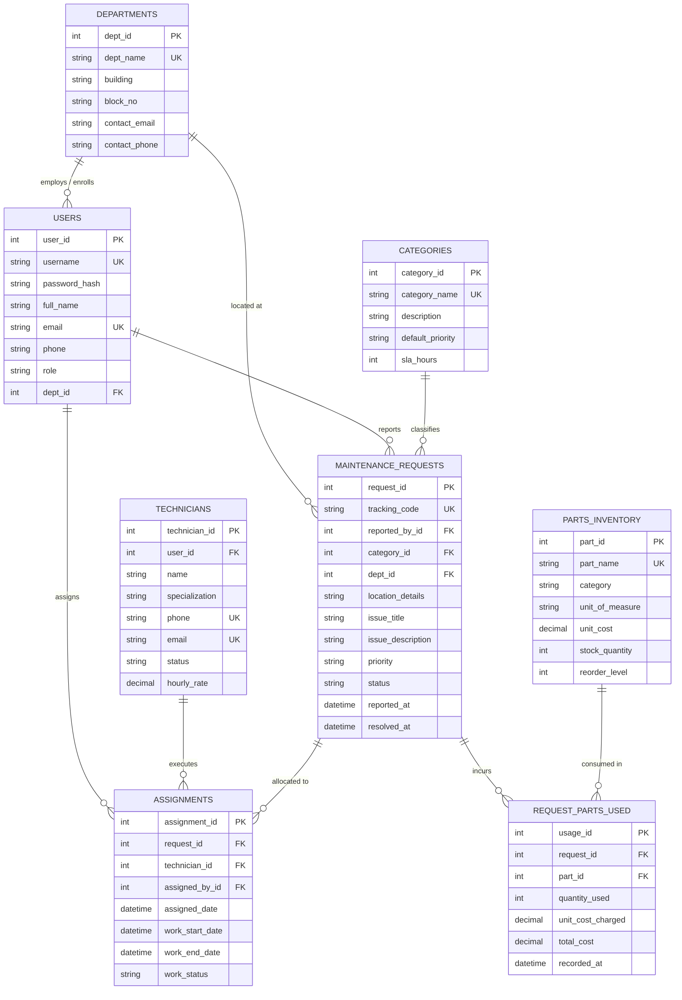

# DATABASE DESIGN SPECIFICATION: ER DIAGRAM & NORMALIZATION
## College Maintenance and Request System
**Course Code:** 24CS305 / CS3106 - DBMS Laboratory

---

## 1. ENTITY-RELATIONSHIP (ER) DIAGRAM

---

## 2. CARDINALITY AND RELATIONSHIPS

1. **`DEPARTMENTS` (1) ─── (N) `USERS`**
   - **Participation:** Mandatory on `USERS` side (each user belongs to exactly one department), Partial on `DEPARTMENTS` side (a department has 1 or more users).
   - **Relationship:** One department houses many students, staff, and faculty.

2. **`DEPARTMENTS` (1) ─── (N) `MAINTENANCE_REQUESTS`**
   - **Participation:** Mandatory on `MAINTENANCE_REQUESTS` side (every request originates from a campus department location).
   - **Relationship:** A department can have multiple repair requests lodged against its facilities over time.

3. **`USERS` (1) ─── (N) `MAINTENANCE_REQUESTS`**
   - **Participation:** Mandatory on `MAINTENANCE_REQUESTS` side (every ticket must be logged by an authenticated user).
   - **Relationship:** One user can lodge multiple maintenance tickets.

4. **`CATEGORIES` (1) ─── (N) `MAINTENANCE_REQUESTS`**
   - **Relationship:** Each category (Electrical, HVAC, Plumbing, etc.) classifies multiple maintenance tickets.

5. **`MAINTENANCE_REQUESTS` (1) ─── (N) `ASSIGNMENTS`**
   - **Relationship:** A single maintenance request can have assignment records documenting work allocation and reassignment history.

6. **`TECHNICIANS` (1) ─── (N) `ASSIGNMENTS`**
   - **Relationship:** A technician can receive multiple assignments over time.

7. **`MAINTENANCE_REQUESTS` (1) ─── (N) `REQUEST_PARTS_USED`**
   - **Relationship:** A repair job can consume multiple replacement parts or consumables.

8. **`PARTS_INVENTORY` (1) ─── (N) `REQUEST_PARTS_USED`**
   - **Relationship:** An inventory item (e.g. 20W LED Batten) can be utilized across multiple repair requests.

---

## 3. RELATIONAL SCHEMA

- **`departments`** ($\underline{\text{dept\_id}}$, $\text{dept\_name}$, $\text{building}$, $\text{block\_no}$, $\text{contact\_email}$, $\text{contact\_phone}$, $\text{created\_at}$)
- **`users`** ($\underline{\text{user\_id}}$, $\text{username}$, $\text{password\_hash}$, $\text{full\_name}$, $\text{email}$, $\text{phone}$, $\text{role}$, $\text{dept\_id}^{\text{FK}}$, $\text{is\_active}$, $\text{created\_at}$)
- **`categories`** ($\underline{\text{category\_id}}$, $\text{category\_name}$, $\text{description}$, $\text{default\_priority}$, $\text{sla\_hours}$, $\text{created\_at}$)
- **`technicians`** ($\underline{\text{technician\_id}}$, $\text{user\_id}^{\text{FK}}$, $\text{name}$, $\text{specialization}$, $\text{phone}$, $\text{email}$, $\text{status}$, $\text{hourly\_rate}$, $\text{created\_at}$)
- **`maintenance_requests`** ($\underline{\text{request\_id}}$, $\text{tracking\_code}$, $\text{reported\_by\_id}^{\text{FK}}$, $\text{category\_id}^{\text{FK}}$, $\text{dept\_id}^{\text{FK}}$, $\text{location\_details}$, $\text{issue\_title}$, $\text{issue\_description}$, $\text{priority}$, $\text{status}$, $\text{reported\_at}$, $\text{updated\_at}$, $\text{resolution\_notes}$, $\text{resolved\_at}$)
- **`assignments`** ($\underline{\text{assignment\_id}}$, $\text{request\_id}^{\text{FK}}$, $\text{technician\_id}^{\text{FK}}$, $\text{assigned\_by\_id}^{\text{FK}}$, $\text{assigned\_date}$, $\text{work\_start\_date}$, $\text{work\_end\_date}$, $\text{work\_notes}$, $\text{work\_status}$)
- **`parts_inventory`** ($\underline{\text{part\_id}}$, $\text{part\_name}$, $\text{category}$, $\text{unit\_of\_measure}$, $\text{unit\_cost}$, $\text{stock\_quantity}$, $\text{reorder\_level}$, $\text{created\_at}$)
- **`request_parts_used`** ($\underline{\text{usage\_id}}$, $\text{request\_id}^{\text{FK}}$, $\text{part\_id}^{\text{FK}}$, $\text{quantity\_used}$, $\text{unit\_cost\_charged}$, $\text{total\_cost}$, $\text{recorded\_at}$, $\text{notes}$)

---

## 4. FUNCTIONAL DEPENDENCIES & 3NF NORMALIZATION

### Functional Dependencies (FDs):
1. **`departments`**:
   $$\text{dept\_id} \rightarrow \text{dept\_name}, \text{building}, \text{block\_no}, \text{contact\_email}, \text{contact\_phone}$$
   $$\text{dept\_name} \rightarrow \text{dept\_id}, \text{building}, \text{block\_no}, \text{contact\_email}, \text{contact\_phone}$$
2. **`users`**:
   $$\text{user\_id} \rightarrow \text{username}, \text{password\_hash}, \text{full\_name}, \text{email}, \text{phone}, \text{role}, \text{dept\_id}$$
   $$\text{username} \rightarrow \text{user\_id}, \text{email}, \dots$$
   $$\text{email} \rightarrow \text{user\_id}, \text{username}, \dots$$
3. **`categories`**:
   $$\text{category\_id} \rightarrow \text{category\_name}, \text{description}, \text{default\_priority}, \text{sla\_hours}$$
4. **`technicians`**:
   $$\text{technician\_id} \rightarrow \text{user\_id}, \text{name}, \text{specialization}, \text{phone}, \text{email}, \text{status}, \text{hourly\_rate}$$
5. **`maintenance_requests`**:
   $$\text{request\_id} \rightarrow \text{tracking\_code}, \text{reported\_by\_id}, \text{category\_id}, \text{dept\_id}, \text{location\_details}, \text{issue\_title}, \text{issue\_description}, \text{priority}, \text{status}, \text{reported\_at}$$
   $$\text{tracking\_code} \rightarrow \text{request\_id}, \dots$$
6. **`assignments`**:
   $$\text{assignment\_id} \rightarrow \text{request\_id}, \text{technician\_id}, \text{assigned\_by\_id}, \text{assigned\_date}, \text{work\_status}$$
7. **`parts_inventory`**:
   $$\text{part\_id} \rightarrow \text{part\_name}, \text{category}, \text{unit\_of\_measure}, \text{unit_cost}, \text{stock\_quantity}, \text{reorder\_level}$$
8. **`request_parts_used`**:
   $$\text{usage\_id} \rightarrow \text{request\_id}, \text{part\_id}, \text{quantity\_used}, \text{unit\_cost\_charged}, \text{total\_cost}, \text{recorded\_at}$$

### Mathematical Justification for 3NF:
In relational database theory, a relational schema $R$ is in **Third Normal Form (3NF)** with respect to a set of functional dependencies $F$ if, for every functional dependency $X \rightarrow Y$ in $F^+$:
1. $Y \subseteq X$ ($X \rightarrow Y$ is trivial), **OR**
2. $X$ is a superkey of $R$, **OR**
3. Each attribute in $Y - X$ is a prime attribute (member of some candidate key of $R$).

In every table of our schema:
- The left-hand side ($X$) of every non-trivial functional dependency is a candidate key / superkey (such as `dept_id`, `user_id`, `request_id`, `part_id`, `tracking_code`, `username`, `email`).
- There are no partial key dependencies (satisfies 2NF).
- There are no transitive dependencies between non-key attributes (satisfies 3NF).
- **Conclusion:** The database satisfies **3NF**.
